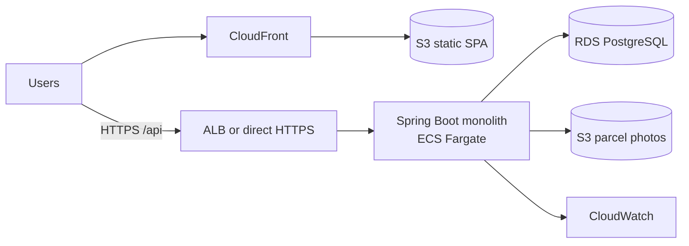

# Architecture review: right-sized for the MVP
n> Hosting-agnostic: nothing in the code depends on AWS. Cloud services named below are optional future options.

Priority order: correctness → security → simplicity → maintainability → performance → scalability.
Rule: every technology must solve a problem we currently have.

## 1. Recommended architecture

| Component | Decision | Justification |
|---|---|---|
| Frontend | React + TS + Vite + Tailwind (SPA) | Behind-login app, so no SEO need for Next.js SSR. Static files on S3 + CloudFront |
| Backend | Spring Boot modular monolith | One team, one deploy, transactional consistency across parcel/capacity/payment |
| Database | PostgreSQL (RDS db.t4g.micro) | Relational, transactional, handles search, locking, constraints |
| Auth | Spring Security + JWT. Cognito later | ~200 MAU; Cognito adds config/lock-in without solving a current problem |
| Files | S3 + presigned URLs (parcel photos, step 3) | Only place object storage is genuinely needed |
| Compute | One container on ECS Fargate (or one EC2) | No Kubernetes, no Lambda glue |
| Edge | CloudFront for the SPA only | Free tier, HTTPS, caching of static assets |
| Logs/metrics | CloudWatch | Included with ECS |
| Cache / queue / search / realtime | **None** | No measured problem. See the triggers below |



## 2. Technology decision matrix

| Technology | Verdict | Why | Trigger to introduce later |
|---|---|---|---|
| React/Vite + TS + Tailwind | USE NOW | Simple SPA | n/a. Next.js only if public SEO pages (landing/route pages) matter |
| shadcn/ui | OPTIONAL | Nice components, extra setup | When the UI grows past ~15 screens |
| Spring Boot, REST | USE NOW | Team skill; REST is enough | n/a |
| PostgreSQL / RDS | USE NOW | System of record | Read replica when read CPU > 70% sustained |
| Flyway | USE NOW | Versioned schema | n/a |
| Cognito | FUTURE | JWT covers MVP | Need social login, MFA, or SSO, or want to stop handling passwords |
| S3 | USE NOW (photos) | Binary files do not belong in Postgres | n/a |
| API Gateway | DON'T USE NOW | Spring Security already does auth; adds cost and a hop | Multiple backends, or per-client throttling/usage plans |
| ECS Fargate / EC2 | USE ONE | Run the container | Autoscaling when CPU > 70% sustained or p95 latency regresses |
| Lambda | DON'T USE NOW | Only for isolated async jobs (e.g. image resize on upload) | A job that does not fit the monolith |
| SQS | FUTURE | Spring `@Scheduled` + DB covers MVP | Slow or flaky external calls (payments/KYC/SMS) that must be retried durably |
| EventBridge | DON'T USE NOW | No cross-service events | Multiple services |
| CloudWatch | USE NOW | Logs, alarms | n/a |
| Redis | DON'T USE NOW | See section 3 | See section 3 |
| OpenSearch | DON'T USE NOW | Indexed SQL handles route/date/capacity filters | Free-text search over >~1M rows or typo-tolerant search |
| Kafka | DON'T USE NOW | 100–500 parcels/month is ~1 per hour | Sustained >1,000 events/s or multiple independent consumers |
| WebSockets/SSE | DON'T USE NOW | Status changes are rare; poll every 15–30 s | Live traveller GPS tracking, or chat |
| Kubernetes | DON'T USE NOW | One container needs no orchestrator | >5 services and a platform team |
| Microservices | DON'T USE NOW | Distributed transactions for capacity + payment would be harder, not easier | Independent scaling or team ownership demands it |

## 3. Why Redis is NOT needed yet

- **Load:** 50 concurrent users is on the order of 1–5 requests/second at peak. A db.t4g.micro PostgreSQL handles hundreds of indexed queries/second.
- **No expensive repeated query exists.** The heaviest read, trip search, hits a partial index on (route, date) and returns a handful of rows.
- **Correctness:** capacity, parcel state and payments are transactional. Caching them risks stale reads (an oversold trip); locks held in Redis can disagree with the database. Postgres row locks and constraints are the right tool.
- **Cost:** ElastiCache is another bill, another network hop, another failure mode, plus cache invalidation and monitoring.
- **Sessions:** JWT is stateless, so there is no session store to put in Redis.
- **Rate limiting:** the in-memory filter on `/api/auth/**` is correct for one instance.

Your position is right. **No caching layer in MVP.** Cache only after profiling shows a bottleneck.

### When we should introduce Redis

| Trigger (measured, sustained) | Response |
|---|---|
| RDS CPU > 60–70% for hours, and the top queries in `pg_stat_statements` are repeated identical reads | Cache that specific read (e.g. rating averages, popular route searches) for 30–60 s |
| p95 of a read endpoint > 300 ms after indexing and query tuning | Same |
| More than 1 API instance and rate limiting must be shared | Prefer AWS WAF rate rules first; Redis if per-user quotas are needed |
| Live traveller location pings at >10 writes/s | Redis (or a stream) for ephemeral location, flushed to Postgres at checkpoints |
| Need distributed scheduled-job coordination across instances | Postgres advisory locks first |

Even then, Postgres stays the source of truth and the cache is disposable.

## 4. Concurrency design (the important part)

Traveller has 20 kg total and 12 kg personal luggage, leaving 8 kg. Two senders each try to book 5 kg at once.

Three layers, implemented in `TripRepository.reserve`, `ParcelRepository.findForUpdate` and the schema:

1. **Atomic guarded UPDATE**: the row lock serialises the two bookings, and the second re-checks against the committed value.
   ```sql
   UPDATE trips SET booked_g = booked_g + :grams
    WHERE id = :id AND status = 'OPEN'
      AND personal_luggage_g + booked_g + :grams <= total_capacity_g;   -- 1 row = reserved, 0 rows = full
   ```
   The first booking commits (booked 5 kg). The second waits on the lock, re-evaluates 12+5+5 = 22 > 20, and updates 0 rows, so the API returns 409.
2. **CHECK constraint** `personal_luggage_g + booked_g <= total_capacity_g`: even a buggy code path cannot overbook.
3. **`SELECT ... FOR UPDATE` on the parcel** for every state transition, so a double-click or double-accept cannot create two payments.

**Idempotency:** `UNIQUE(parcel_id)` on payments, state checks inside the locked transaction, and `UNIQUE(parcel_id, rater_id)` on ratings. A retried request fails safely with 409 instead of duplicating.

Verified by `CarryonApplicationTests.concurrentAcceptsNeverOverbookTheTrip`.

## 5. Search

Route + date window + spare capacity + rating sort is one query against a partial index `(lower(origin), lower(destination), departure_date) WHERE status='OPEN'`. Ratings are averaged in a second query and sorted in memory over ≤50 rows. Upgrade path: `pg_trgm` / full-text in Postgres before any search engine.

## 6. Real-time and messaging

- **Real-time:** the client polls `/api/notifications` and parcel endpoints every 15–30 s. SSE is the next step; WebSockets only for live GPS or chat.
- **Messaging:** synchronous calls inside one transaction. The only async work is `@Scheduled` auto-release of escrow. Add SQS when an external call (real payment gateway, SMS) needs durable retries.

## 7. Modular monolith

```
com.carryon
├── auth          register/login, JWT issue, admin seed
├── users         profile, mock KYC
├── trips         trip CRUD, capacity reservation SQL
├── parcels       state machine, QR custody, audit events
├── matching      search + suggested trips (reads trips/ratings)
├── payments      escrow ledger (HELD → RELEASED/REFUNDED)
├── notifications in-app notifications
├── disputes      loss/damage reports, admin resolution
├── ratings       post-delivery ratings
├── admin         user/parcel moderation
├── config        security, properties, rate limiting
└── common        errors, current-user helper
```

Rules: modules talk through service classes, never through each other's tables directly (the current exceptions are read-only repository queries across `trips`/`parcels`). Each module can later become a service because its state lives in its own tables, so the first extraction candidates are `notifications` and `payments`. The honest limitation: today `parcels` calls `payments` and `trips` in one DB transaction. Splitting those later needs a saga or outbox.

## 8. Security

| Threat | Control |
|---|---|
| Fake travellers | KYC gate before posting trips (mock now; vendor later, store verdict + reference only) and ratings |
| Account takeover / brute force | BCrypt, rate-limited `/api/auth/**`, generic login errors, 60 min token TTL |
| Unauthorised access | JWT on every route, role-based `/api/admin/**`, per-object ownership checks (404 for non-participants) |
| Parcel tampering / chain of custody | Single-use QR tokens (128-bit random, constant-time compare), append-only `parcel_events` |
| Payment fraud | Escrow state machine; double payment blocked by `UNIQUE(parcel_id)`; real gateway later |
| Malicious parcels | Mandatory prohibited-items declaration, declared-value cap, weight limits |
| SQL injection | JPA with bound parameters only |
| XSS | React escapes output; JSON API; strict `Content-Type`; add CSP at CloudFront |
| CSRF | Not applicable: bearer tokens in the Authorization header, no cookies |
| File uploads (step 3) | Presigned S3 PUT, content-type and size limits, random keys, private bucket |
| Data minimisation | No Aadhaar/PAN/document images stored. The recipient phone is hidden from travellers until a request is accepted |
| Encryption | TLS in transit; RDS and S3 encryption at rest |

Known limitation: QR tokens are stored in plaintext so the sender can re-display them. Acceptable for an MVP, and they are only ever returned to the sender.

## 9. Cost and complexity

| | Minimal MVP (this design) | Over-engineered |
|---|---|---|
| Services | RDS, 1 Fargate task/EC2, S3, CloudFront | + ElastiCache, MSK/Kafka, OpenSearch, EKS, API Gateway, Cognito, SQS |
| Monthly cost (rough) | ~$25–45 (≈$0 first year on the free tier) | ~$600–1,500+ (EKS control plane ≈ $73, MSK ≈ $200+, OpenSearch ≈ $100+, NAT ≈ $35) |
| Things to monitor/patch | 3 | 10+ |
| Failure modes | DB, app | + cache invalidation bugs, broker lag, index drift, cluster upgrades, service-to-service auth |

## 10. Scaling roadmap

| Stage | Architecture | What changes (only when the metric says so) |
|---|---|---|
| 200 MAU | As above | Nothing |
| 10,000 MAU | Same | 2 app instances behind a load balancer; RDS to t4g.small/medium; WAF rate rules; SQS for payment webhooks and notification email/SMS; SSE for status |
| 100,000 MAU | Same monolith, more headroom | Read replica for search; Redis for hot cached reads (if the triggers fired); Postgres full-text / trigram search; Cognito if login features demand it; autoscaling |
| 1M+ | Extract by pain | Extract notifications/payments; consider OpenSearch for search; partition large tables; Kafka only for real multi-consumer event streams |

## 11. Verdict

**Build now:** Spring Boot monolith, PostgreSQL + Flyway, JWT auth, React SPA, S3 for photos, CloudWatch, one container, mock KYC and payments.

**Do not build now:** Redis, Kafka, OpenSearch, Kubernetes, microservices, WebSockets, API Gateway, Lambda, EventBridge, SQS.

**Monitor:** RDS CPU and connections, p95 latency per endpoint, slow queries (`pg_stat_statements`), API 5xx rate, 409 capacity-conflict rate, container CPU/memory.

**Revisit when:** RDS CPU > 70% sustained after query tuning; p95 > 500 ms on core endpoints; more than one API instance is needed; external calls need durable retries; live GPS tracking becomes a feature.
