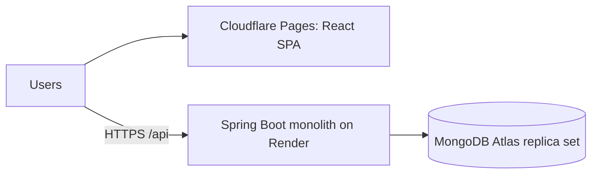

# Architecture: right-sized for the MVP

Priority order: correctness → security → simplicity → maintainability → performance → scalability.
Rule: every technology must solve a problem we currently have.

## 1. Stack

| Component | Decision | Justification |
|---|---|---|
| Frontend | React + TS + Vite + Tailwind (SPA) | Behind-login app, so no SEO need for Next.js SSR; static hosting is free |
| Backend | Spring Boot modular monolith | One team, one deploy, one transaction boundary across parcel/capacity/payment |
| Database | MongoDB (replica set) | Document model fits parcels, trips and their event trail; atomic single-document updates and multi-document transactions cover the consistency needs |
| Auth | Spring Security + JWT | ~200 MAU; a managed identity service adds config without solving a current problem |
| Hosting | Free tier: MongoDB Atlas M0, Render, Cloudflare Pages | $0 and no card |
| Cache / queue / search / realtime | **None** | No measured problem. See section 3 |



## 2. Technology decision matrix

| Technology | Verdict | Why | Trigger to introduce later |
|---|---|---|---|
| React/Vite + TS + Tailwind | USE NOW | Simple SPA | Next.js only if public SEO pages matter |
| Spring Boot, REST | USE NOW | Team skill; REST is enough | n/a |
| MongoDB | USE NOW | System of record | Atlas dedicated tier when M0 limits (512 MB, shared CPU) bind |
| Managed identity (Cognito/Auth0) | FUTURE | JWT covers MVP | Social login, MFA, SSO |
| Object storage (S3/R2) | FUTURE | Parcel photos not built yet | When photo uploads ship |
| API gateway | DON'T USE NOW | Spring Security already does auth | Multiple backends or per-client throttling |
| Queue (SQS etc.) | FUTURE | `@Scheduled` + DB covers MVP | Slow or flaky external calls (payments/KYC/SMS) that need durable retry |
| Redis | DON'T USE NOW | See section 3 | See section 3 |
| Search engine | DON'T USE NOW | Indexed queries handle route/date/capacity filters | Free-text or typo-tolerant search at large scale (Atlas Search first) |
| Kafka | DON'T USE NOW | 100–500 parcels/month is ~1 per hour | Sustained >1,000 events/s or several independent consumers |
| WebSockets/SSE | DON'T USE NOW | Status changes are rare; poll every 20 s | Live GPS tracking or chat |
| Kubernetes, microservices | DON'T USE NOW | One container needs no orchestrator | >5 services and a platform team |

## 3. Why Redis is NOT needed yet

- **Load:** 50 concurrent users is roughly 1–5 requests/second at peak. A small MongoDB handles hundreds of indexed queries/second.
- **No expensive repeated query exists.** The heaviest read, trip search, hits a compound index on (origin, destination, date) and returns a handful of documents.
- **Correctness:** capacity, parcel state and payments are transactional. Caching them risks stale reads (an oversold trip). The database is the single source of truth.
- **Cost and ops:** another service, another failure mode, plus cache invalidation and monitoring.
- **Sessions:** JWT is stateless, so there is no session store to put in Redis.
- **Rate limiting:** the in-memory filter on `/api/auth/**` is correct for one instance.

**No caching layer in MVP.** Cache only after profiling shows a bottleneck.

### When Redis becomes justified

| Trigger (measured, sustained) | Response |
|---|---|
| Database CPU > 60–70% for hours, and the Atlas profiler shows repeated identical reads | Cache that specific read for 30–60 s |
| p95 of a read endpoint > 300 ms after indexing and query tuning | Same |
| More than 1 API instance and rate limiting must be shared | Edge/WAF rate rules first; Redis if per-user quotas are needed |
| Live traveller location pings at >10 writes/s | Redis (or a stream) for ephemeral location, flushed to MongoDB at checkpoints |

Even then, MongoDB stays the source of truth and the cache is disposable.

## 4. Concurrency design (the important part)

A traveller has 20 kg total and 12 kg personal luggage, leaving 8 kg. Two senders each try to book 5 kg at once. MongoDB has no row locks or CHECK constraints, so the guarantees are built from other primitives:

1. **Atomic conditional update** (`TripOps.reserve`): one `updateOne` whose filter includes `status = OPEN AND availableG >= grams` and whose update is `$inc availableG -grams, bookedG +grams`. MongoDB applies filter and update atomically to the single trip document, so two bookings can never both pass the check.
   ```js
   db.trips.updateOne(
     { _id: tripId, status: "OPEN", availableG: { $gte: grams } },
     { $inc: { availableG: -grams, bookedG: grams } })      // modifiedCount 1 = reserved, 0 = full
   ```
2. **Multi-document transaction** around *accept*: reserve capacity + create the payment + move the parcel to ACCEPTED all commit together or not at all, so a failure can never leak capacity.
3. **Optimistic locking** (`@Version` on parcels): two concurrent transitions on the same parcel cannot both commit.
4. **Retry on write conflict** (`Tx`): MongoDB aborts the loser of a conflict instead of making it wait (PostgreSQL would block on the row lock). The whole transaction is retried, re-reads fresh state, and the loser then sees "trip full" or "already accepted" and gets a clean 409.

**Idempotency:** unique index on `payments.parcelId` (one payment per parcel), state checks inside the transaction, unique index on `ratings(parcelId, raterId)`, unique `users.email`, and a partial unique index allowing one OPEN dispute per parcel.

Verified by `CarryonApplicationTests.concurrentAcceptsNeverOverbookTheTrip` (10 parcels compete for 8 kg: exactly 5 accepted) and `doubleAcceptOfSameParcelIsRejected`.

### Honest tradeoffs of choosing MongoDB here
- PostgreSQL gives a database-level `CHECK` that makes overbooking impossible even for buggy code. In MongoDB the same invariant lives in one code path (`TripOps`), so `bookedG`/`availableG` must never be written any other way.
- Transactions require a replica set (Atlas free tier and `docker-compose.yml` provide one) and need retry handling.
- Relational reporting across parcels, payments and users is easier in SQL. For this app's access patterns (look up by id, by route, by owner) documents are a good fit.

## 5. Search

Route + date window + spare capacity is one query against the compound index `(originKey, destinationKey, departureDate)`, with city names stored lower-cased for case-insensitive exact matching. Ratings are averaged in memory over at most 50 results. Upgrade path: Atlas Search before any separate search engine.

## 6. Real-time and messaging

- **Real-time:** the client polls `/api/notifications` every 20 s. SSE is the next step; WebSockets only for live GPS or chat.
- **Messaging:** synchronous calls inside one transaction. The only async work is `@Scheduled` auto-release of escrow. Add a queue when an external call (real payment gateway, SMS) needs durable retries.

## 7. Modular monolith

```
com.carryon
├── auth          register/login, JWT issue, admin seed
├── users         profile, mock KYC
├── trips         trip CRUD, atomic capacity operations (TripOps)
├── parcels       state machine, QR custody, audit events
├── matching      search + suggested trips
├── payments      escrow ledger (HELD → RELEASED/REFUNDED)
├── notifications in-app notifications
├── disputes      loss/damage reports, admin resolution
├── ratings       post-delivery ratings
├── admin         user/parcel moderation
├── config        security, Mongo indexes/transactions, rate limiting
└── common        errors, current-user helper, transaction+retry helper (Tx)
```

Modules talk through service classes. Each module's state lives in its own collections, so extraction later is possible. The honest limitation: `parcels` calls `payments` and `trips` inside one database transaction, so splitting them would need a saga or outbox.

## 8. Security

| Threat | Control |
|---|---|
| Fake travellers | KYC gate before posting trips (mock now; vendor later, store verdict + reference only) and ratings |
| Account takeover / brute force | BCrypt, rate-limited `/api/auth/**`, generic login errors, 60 min token TTL |
| Unauthorised access | JWT on every route, role-based `/api/admin/**`, per-object ownership checks (404 for non-participants) |
| Parcel tampering / chain of custody | Random 128-bit QR tokens with constant-time compare, append-only `parcel_events` |
| Payment fraud | Escrow state machine; double payment blocked by a unique index; real gateway later |
| Malicious parcels | Mandatory prohibited-items declaration, declared-value cap, weight limits |
| NoSQL injection | Typed repositories and `Criteria` API only; request bodies bind to typed records, never raw query documents |
| XSS | React escapes output; JSON API |
| CSRF | Not applicable: bearer tokens in the Authorization header, no cookies |
| Data minimisation | No Aadhaar/PAN/document images stored. Recipient phone hidden from travellers until a request is accepted |
| Encryption | TLS in transit; Atlas encrypts at rest |

Known limitation: QR tokens are stored in plaintext so the sender can re-display them. Acceptable for an MVP; they are only ever returned to the sender.

## 9. Scaling roadmap

| Stage | What changes (only when the metric says so) |
|---|---|
| 200 MAU | Nothing |
| 10,000 MAU | Atlas paid tier; 2 app instances; edge rate limiting; a queue for payment webhooks and email/SMS; SSE for status |
| 100,000 MAU | Read preference for secondary reads; Redis for hot cached reads if triggers fired; Atlas Search; autoscaling |
| 1M+ | Extract notifications/payments; shard by need; Kafka only for real multi-consumer streams |

## 10. Verdict

**Build now:** Spring Boot monolith, MongoDB replica set, JWT auth, React SPA, mock KYC and payments.

**Do not build now:** Redis, Kafka, a search engine, Kubernetes, microservices, WebSockets, an API gateway.

**Monitor:** database CPU and connections, p95 latency per endpoint, slow queries (Atlas profiler), API 5xx rate, 409 capacity-conflict rate, transaction retry counts.

**Revisit when:** database CPU > 70% sustained after index tuning; p95 > 500 ms on core endpoints; more than one API instance is needed; external calls need durable retries; live GPS tracking becomes a feature.
